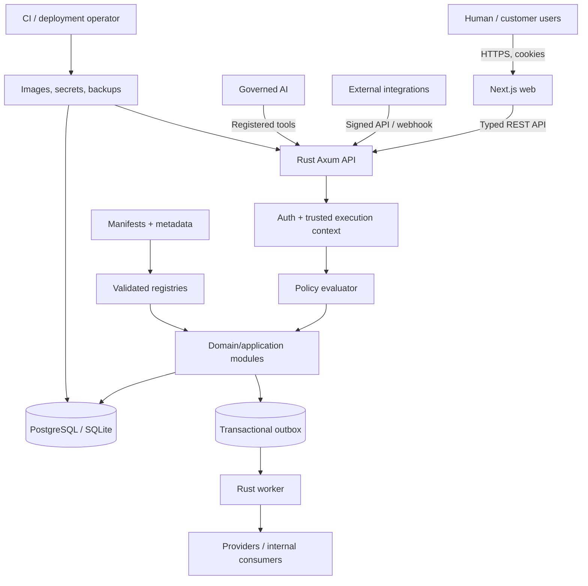

# URP — Initial Platform Threat Model

**Status:** design baseline. Controls listed here are required implementation work; this document is not evidence that the code is already secure.

## Security objectives and critical assets

URP must preserve confidentiality, integrity, availability, tenant isolation and accountability across human users, business modules, background workers, external integrations and governed AI agents.

Critical assets include:
- Password hashes, sessions, service credentials, signing/encryption keys and database credentials.
- Tenant/company/branch membership and authorization policy.
- Customer, supplier, employee and financial/business records.
- Posted accounting entries, payments, stock movements, reservations and valuation history.
- Module manifests, model metadata, query definitions, migrations and workflow rules.
- Documents, attachments, backups, event payloads, audit records and integration secrets.
- AI tool definitions, run history, approval decisions and model/provider payloads.

## Trust boundaries

1. Browser/API boundary: all request bodies, headers, cookies and selected tenant IDs are untrusted.
2. API/domain boundary: trusted actor/context is created only after authentication and membership validation.
3. Module/metadata boundary: manifests and metadata are declarative input; arbitrary scripts are not executable.
4. Runtime/database boundary: application roles are least privilege; schema migrations use a separate privileged role.
5. Worker/provider boundary: delivery is at-least-once; callbacks and payloads are externally controlled.
6. AI/retrieval boundary: model outputs and retrieved documents are untrusted data; they do not define authorization.
7. CI/operator boundary: dependencies, build artifacts, secrets, database files and backups require supply-chain and operational controls.

## Threat register

| ID | Attack surface and abuse case | Severity | Required control | Required evidence |
|---|---|---|---|---|
| T01 | Authentication: credential stuffing, password spraying, stolen-cookie replay or session fixation | Critical | Vetted password hashing, rate limits, secure HttpOnly cookies, rotation, expiry and revocation | Auth tests for lockout/rate limit, replay, rotation and expiry; #31–#32 |
| T02 | Tenant scope: client selects another tenant/company or pooled DB connection retains prior context | Critical | Derive tenant from authenticated membership; typed context; mandatory tenant predicate; transaction-scoped DB context | Cross-tenant and pool-reuse tests; #18, #34, #37, #51 |
| T03 | Authorization: IDOR, hidden fields, aggregate/export leakage, unauthorized file access | Critical | Default-deny server-side model/action/field/record policies on every query, command, export and download | Access matrix for read/count/write/delete/search/report/export/file; #35–#38, #51, #169 |
| T04 | Query/metadata compiler: injected identifiers/operators, raw SQL, pathological filters | Critical | Typed AST, allowlisted identifiers/operators, bound values, bounded depth/size/page, tenant filters outside user boolean logic | Injection/property tests and OR/NOT tenant-bypass tests; #40–#51 |
| T05 | Module runtime: path traversal, dependency confusion, partial install or incompatible version | High | Strict manifest schema, namespaced IDs, deterministic graph resolver, checksum, dry-run and post-commit activation | Malformed manifest, cycle, rollback and upgrade tests; #54–#62 |
| T06 | Dynamic schema: field type change/removal silently deletes customer data | Critical | Versioned schema plan, impact preview, explicit migrations and backup requirement; no startup DDL | Migration planner and restore/upgrade tests; #50, #166 |
| T07 | Financial integrity: unbalanced/duplicate posting, floating point, period bypass or posted-entry mutation | Critical | Exact decimal; balanced transactional posting; idempotency; period locks; immutable posted entries; linked reversal | Property, concurrency, immutability and reconciliation tests; #99–#111 |
| T08 | Inventory integrity: direct on-hand mutation, double reservation or replayed receipt/delivery | Critical | Append-only movement ledger, race-safe reservation, compensating movements and idempotent commands | Conservation, concurrency, replay and valuation tests; #90–#97 |
| T09 | File handling: path traversal, spoofed MIME, oversized archive or revoked user downloads | High | Generated storage keys, size/type validation, safe preview/quarantine, tenant/record check per download | Traversal, MIME, oversized file and revoked-access tests; #129–#130 |
| T10 | Webhooks/integrations: forged callbacks, replay, SSRF, leaked or stale credentials | High | Signature/timestamp verification, replay window, idempotency, outbound destination policy, rotation and egress controls | Invalid/replayed signature, SSRF and rotation tests; #149, #154–#155 |
| T11 | Jobs/outbox: crash after commit, duplicate event delivery, expired lease or poison payload | High | Transactional outbox, durable job state, lease recovery, bounded retry/dead letter, idempotent consumers | Crash/retry/dedupe/dead-letter tests; #74, #143–#145 |
| T12 | Workflow/AI: prompt injection or malicious condition triggers data exfiltration or unauthorized action | Critical | Typed condition AST, registered tools only, server-side policy recheck, risk tier and human approval for sensitive actions | Prompt-injection, tool-denial, approval-tamper and redaction evals; #146–#158 |
| T13 | Secrets/logging: credentials appear in source, logs, telemetry, URLs or client bundle | High | Secret injection, least privilege, redaction, rotation, no secrets in browser code | Secret scan, log redaction, bundle inspection and rotation rehearsal; #165, #167 |
| T14 | Supply chain: compromised dependency/action or unreviewed artifact enters release | High | Lockfiles, reviewed action versions, dependency/container scan, SBOM and release provenance | CI scan and artifact-provenance evidence; #167, #174 |
| T15 | Backup/recovery: backup theft, inconsistent DB snapshot or untested restore | Critical | Encryption, access separation, retention, integrity check and restore rehearsal | Automated clean-environment restore and access review; #163, #175 |
| T16 | Availability/privacy: expensive query/export, upload flood, job storm or unnecessary HR/customer data exposure | High | Rate limits, query budgets, pagination, bounded concurrency, data minimization and log redaction | Load, query-budget, HR field-matrix and AI outbound-payload tests; #150–#153, #158, #168–#169 |

## Required invariants

- Tenant identity is derived from authenticated membership, never a request body/header.
- Company and branch scopes are revalidated for every API request and background job.
- Tenant-owned persistence queries cannot execute without trusted context.
- UI hiding is not authorization; Rust checks every query, command, aggregate, export and file read.
- Metadata cannot execute raw SQL, JavaScript, Python, shell commands or arbitrary expressions.
- Domain state and outbox event rows commit in one transaction.
- Posted accounting records and stock movements are not silently edited/deleted.
- AI uses registered tools, existing application APIs, the same policies as human operators and required approvals.
- Passwords, tokens, session cookies, provider secrets and payment-card data are never logged.
- Migration credentials are separate from API/worker runtime credentials.

## Production verification gates

1. Run at least two tenants with multiple company/role combinations through adversarial isolation tests.
2. Test the actual least-privilege application DB role, not a PostgreSQL superuser or table owner.
3. Test query compiler injection, resource limits and boolean tenant-filter bypass.
4. Exercise module install/upgrade failure and metadata schema recovery.
5. Exercise journal posting, reservations and webhooks under concurrency/retries.
6. Run dependency, container, secret and SBOM scans.
7. Rehearse encrypted backup restoration.
8. Run offline AI prompt-injection/tool-policy evaluations without live provider credentials.
9. Obtain qualified accounting/payroll/legal review before activating jurisdiction-specific localization.

## Residual risk

This threat model is an initial design baseline only. Each mitigation must be implemented and tested in its owning issue. New module families, external providers or AI capabilities require a threat-model update before production activation.
