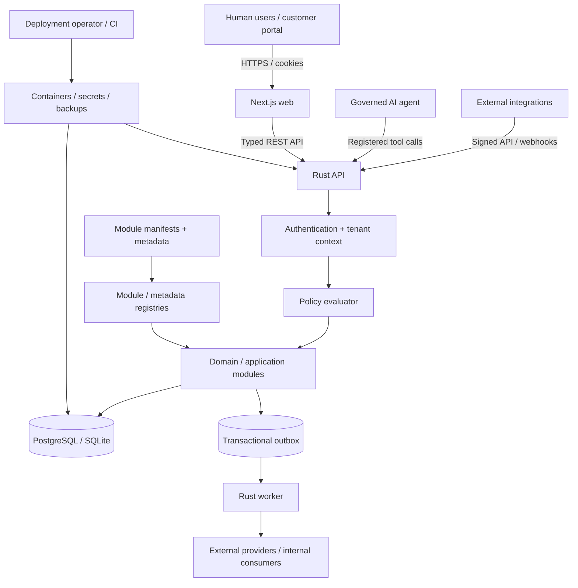

# URP — Initial Platform Threat Model

**Baseline date:** 2026-11-11  
**Status:** initial design review; implementation controls are tracked by the linked GitHub issues. This document is not a claim that the implementation is already secure.

## 1. Purpose and security objectives

URP is a multi-tenant ERP with financially and operationally consequential data. The security objective is to preserve confidentiality, integrity, availability, accountability and tenant isolation across human users, integrations, modules, background jobs and governed AI tools.

Highest impact assets:
- Credentials, sessions, API credentials and encryption keys.
- Tenant/company/branch membership and authorization policy.
- Customer, employee, supplier and other personal/business records.
- Accounting journals, posted invoices, payments and reconciliation records.
- Inventory movement, reservations, lot/serial traceability and valuation.
- Module manifests, metadata registry, schema migrations and workflow definitions.
- Documents, attachments, backups, event payloads and audit history.
- Integration secrets, webhook endpoints, AI tool definitions and run history.

## 2. Trust boundaries

Trust boundaries:
1. Browser to API: all inputs, cookies and client-selected tenant/company IDs are untrusted.
2. API to application/domain: only validated actor and execution context is trusted.
3. Module/metadata boundary: manifests and metadata are declarative, validated input; no arbitrary code execution.
4. Database boundary: API and worker use least-privilege application roles; migrations use a separate privileged role.
5. Worker/provider boundary: events and callbacks are at-least-once and externally controlled.
6. AI/retrieval boundary: model output and retrieved content are untrusted; tool policy remains authoritative.
7. Operator/CI boundary: source, dependencies, build artifacts, deployment secrets and backups require supply-chain controls.

## 3. Threat register

| ID | Asset / attack surface | Abuse case | Severity | Required control | Test / evidence |
|---|---|---|---|---|---|
| T-01 | Authentication and sessions | Credential stuffing, password spraying, stolen cookie replay, session fixation | Critical | Vetted password hashing, rate limits, secure HttpOnly cookies, session rotation/revocation, generic auth failures, MFA follow-up | Auth tests for rate limiting, rotation, expiry, replay and disabled accounts; issue #31–#32 |
| T-02 | Tenant context | Attacker submits another tenant/company ID or reuses pooled DB connection context | Critical | Resolve scope from authenticated membership; typed context; mandatory tenant predicates; transaction-scoped DB context; default deny | Cross-tenant and pool-reuse tests; issue #34, #37, #51 |
| T-03 | Record and field authorization | IDOR, hidden-field leakage, unauthorized aggregate/export/download | Critical | Server-side model/action/field/record policy on every path; reauthorization on file/search/report/export access | Read/count/update/delete/export/file/report/search authorization matrix; issue #36–#38, #51, #169 |
| T-04 | Metadata/domain query compiler | Injected identifiers/operators, raw SQL smuggling, expensive recursive filter | Critical | Typed AST, identifier/operator allowlists, bound values, depth/node/page limits, tenant predicate outside user boolean tree | Injection/property tests, adversarial OR/NOT tenant-bypass and query budget tests; issue #44–#47, #51 |
| T-05 | Module manifests and lifecycle | Path traversal, dependency confusion, incompatible module or partial activation | High | Strict manifest schema, namespaced IDs, deterministic resolver, checksums, dry-run, activation after commit, no arbitrary scripts | Invalid path/manifest/cycle/rollback/upgrade tests; issue #54–#62 |
| T-06 | Dynamic schema changes | Destructive field removal/type change silently deletes customer data | Critical | Versioned schema planner, impact preview, explicit migration steps, backup requirement, no startup DDL | Add/rename/type-change/remove plan tests; migration and restore rehearsal; issue #50, #166 |
| T-07 | Financial integrity | Unauthorized/duplicate posting, unbalanced journal, floating-point rounding or mutation of posted entry | Critical | Exact decimal, balanced posting transaction, idempotency, period locks, immutable posted records, reversal-only correction, audit | Property tests, concurrent duplicate post/reversal, journal reconciliation and immutability tests; issue #99–#111 |
| T-08 | Inventory integrity | Direct on-hand mutation, double reservation, replayed receipt/delivery or hidden negative stock | Critical | Append-only movement ledger, race-safe reservation, explicit compensating movement, transaction and idempotency | Concurrent reservation, movement conservation, receipt/delivery retry and valuation reconciliation; issue #90–#97 |
| T-09 | Uploads and documents | Path traversal, spoofed MIME, oversized archive, malicious active content or unauthorized file download | High | Generated storage key, size/type validation, quarantine/scanning extension, protected storage, permission check per download, safe preview | Traversal/MIME/size/content and revoked-access tests; issue #129–#130 |
| T-10 | Webhooks and integrations | Forged callback, replay, SSRF to internal endpoint, secret theft or duplicate action | High | Signature + timestamp verification, replay window, idempotency, outbound destination policy, secret rotation, egress controls | Invalid/expired/replayed signature, SSRF allowlist and rotation tests; issue #149, #154–#155 |
| T-11 | Jobs and event delivery | Crash between DB commit and publish, duplicate delivery, expired lease or poison event | High | Transactional outbox, durable job state, lease recovery, bounded retries, dead-letter status and idempotent consumer | Crash/retry/dedupe/dead-letter tests; issue #74, #143–#145 |
| T-12 | Workflow and automation | Malicious condition/action executes arbitrary code or bypasses approval | Critical | Typed condition AST, registered actions only, policy recheck per invocation, risk tier and explicit approval | DSL injection tests, denied tool/action, payload tamper and retry tests; issue #146–#147, #156–#157 |
| T-13 | AI and retrieved content | Prompt injection in email/document/search result causes data exfiltration or unauthorized transaction | Critical | Treat retrieved text as untrusted data; no direct DB/shell/network; allowlisted tools; same server authorization; human approval for high-risk actions | Offline prompt-injection, cross-tenant exfiltration and unauthorized action evals; issue #156–#158 |
| T-14 | Secrets and logs | Credentials appear in repo, build logs, telemetry, URLs or browser bundle | High | Secret injection, masking/redaction, least privilege, rotation, no secrets in client code or source control | Secret scan, redaction tests, bundle inspection and rotation rehearsal; issue #165, #167 |
| T-15 | Supply chain and CI | Compromised dependency/action or unreviewed build artifact enters release | High | Lockfiles, pinned action versions, dependency audit, SBOM, container scan, provenance and protected release gate | CI scan evidence and release artifact provenance; issue #167, #174 |
| T-16 | Backups and recovery | Backup theft, incomplete WAL backup, restore from untrusted snapshot or untested recovery | Critical | Encryption, access separation, retention, integrity checks, restore rehearsal, documented RPO/RTO | Automated PostgreSQL/SQLite restore test and access review; issue #163, #175 |
| T-17 | Availability and resource exhaustion | Expensive report/search/filter, unbounded export, upload flood or job retry storm | High | Rate limits, query budgets, pagination, bounded concurrency, backoff, request/job timeout and metrics | Load tests and query-budget tests; issue #150–#153, #168 |
| T-18 | Privacy and personnel data | Excessive employee/customer data exposure in UI, logs, reports or AI provider payloads | High | Data minimization, purpose-specific access, field rules, retention policy, redacted observability, provider data policy | HR field matrix, log redaction and AI outbound payload tests; issue #113, #158, #169 |

## 4. Required security invariants

- Tenant identity is derived from authenticated membership, never trusted from a request body/header.
- Company and branch selection is revalidated against membership and policy on each request/job.
- Every tenant-owned persistence query requires trusted context.
- UI visibility is not authorization; Rust checks every command, query, aggregate, export and file access.
- Metadata cannot contain raw SQL, JavaScript, Python, shell commands or arbitrary executable expressions.
- Domain state changes and outbox events commit in one database transaction.
- Posted accounting entries and stock movements are not silently edited or deleted.
- AI agents use registered tools, the same policies as human operators, and required approval gates.
- Secrets, passwords, session cookies, payment-card data and sensitive payloads are never logged.
- Database migration credentials are separate from runtime credentials.

## 5. Security verification plan

Before production:
1. Run a tenant isolation suite with at least two tenants and multiple company/role combinations.
2. Run API authorization tests against the real application DB role, not a superuser.
3. Review SQL/query compiler for raw identifier/value injection and query exhaustion.
4. Test module install/upgrade failures and metadata schema migration rollback/recovery.
5. Test financial posting, stock reservations and webhook consumers under retries/concurrency.
6. Run dependency, container, secret and SBOM scans.
7. Rehearse encrypted backup restore on a clean environment.
8. Run AI prompt-injection and tool-policy evaluations without live provider credentials.
9. Obtain domain review for legal/accounting/payroll localization before activating country rules.

## 6. Residual risks and ownership

This is an initial threat model for design and backlog traceability. It does not demonstrate that mitigations exist in code. Each control must be implemented and tested in its owning issue. New module families, external providers and new AI capabilities require a threat-model update before production activation.
